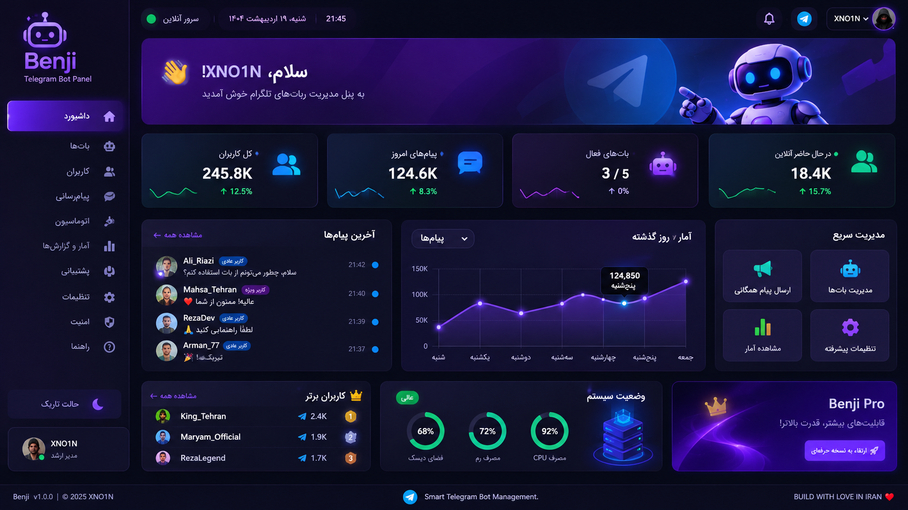

# 🤖 Benji
### پلتفرم مدیریت ربات‌های تلگرام

<p align="center">
  <strong>یک پنل، کنترل کامل، مدیریت هوشمند ربات‌های شما.</strong>
</p>

<p align="center">
  <a href="README.md">🇬🇧 English</a> |
  🇮🇷 <strong>فارسی</strong> |
  <a href="README.tr.md">🇹🇷 Türkçe</a>
</p>

<p align="center">
  
</p>

---

## ✨ امکانات

- 🤖 مدیریت چندین ربات تلگرام
- 👥 مدیریت کاربران
- 💬 دریافت و پاسخ به پیام کاربران
- 📢 ارسال پیام همگانی
- ⚡ ساخت دستورات اختصاصی و پاسخ خودکار
- 📊 داشبورد آمار و گزارش‌ها
- 🎫 سیستم پشتیبانی
- 📱 اتصال به Telegram Mini App
- 🔐 مدیریت امنیت و سطح دسترسی
- 🎨 رابط کاربری مدرن و واکنش‌گرا

## 🛠️ فناوری‌های مورد استفاده

| فناوری | کاربرد |
|---|---|
| Python | زبان برنامه‌نویسی |
| FastAPI | بک‌اند |
| aiogram 3 | اتصال به تلگرام |
| React | فرانت‌اند |
| TypeScript | توسعه رابط کاربری |
| PostgreSQL | پایگاه داده |
| Redis | کش و صف پردازش |
| Docker | استقرار |

## 🚀 نصب و راه‌اندازی

### پیش‌نیازها

- Python نسخه 3.11 یا بالاتر
- Node.js
- PostgreSQL
- Redis
- توکن ربات تلگرام

### دریافت پروژه

```bash
git clone https://github.com/xno1n/benji.git
cd benji
```

### نصب وابستگی‌ها

```bash
pip install -r requirements.txt
```

### تنظیمات محیطی

یک فایل با نام `.env` بسازید:

```env
BOT_TOKEN=your_telegram_bot_token
DATABASE_URL=your_database_url
REDIS_URL=your_redis_url
SECRET_KEY=your_secret_key
```

سپس برنامه را طبق دستورالعمل اجرای پروژه راه‌اندازی کنید.

## 🗺️ نقشه راه

- [ ] مدیریت چند ربات
- [ ] صندوق پیام زنده
- [ ] پاسخ‌گویی مدیر
- [ ] مدیریت کاربران
- [ ] سیستم پیام همگانی
- [ ] سیستم اتوماسیون
- [ ] داشبورد آمار
- [ ] Telegram Mini App
- [ ] مدیریت تیم
- [ ] استقرار با Docker
- [ ] مستندات کامل

## 🔐 امنیت

- نگهداری امن اطلاعات حساس
- محافظت از پنل مدیریت
- اعتبارسنجی ورودی‌ها
- مدیریت سطح دسترسی
- محافظت از توکن‌ها و اطلاعات خصوصی

## 🤝 مشارکت در توسعه

از مشارکت شما استقبال می‌کنیم.

1. پروژه را Fork کنید.
2. یک Branch جدید بسازید.
3. تغییرات خود را اعمال کنید.
4. Pull Request ارسال کنید.

## 📄 مجوز

برای اطلاعات مجوز استفاده، بخش License مخزن را بررسی کنید.

---

<p align="center">
  <strong>BENJI</strong>
  <br>
  مدیریت هوشمند ربات‌های تلگرام
  <br><br>
  <strong>BUILD WITH LOVE IN IRAN ❤️</strong>
  <br>
  <strong>XNO1N</strong>
</p>
