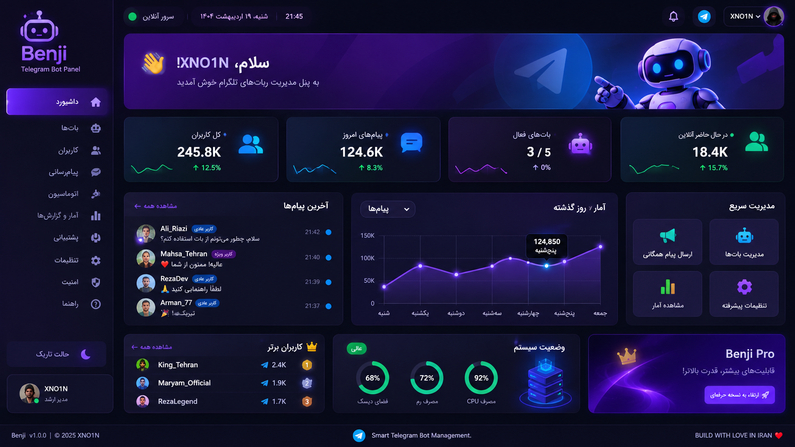

# 🤖 Benji
### Telegram Bot Yönetim Platformu

<p align="center">
  <strong>Tek Panel. Tam Kontrol. Botlarınız, Kurallarınız.</strong>
</p>

<p align="center">
  <a href="README.md">🇬🇧 English</a> |
  <a href="README.fa.md">🇮🇷 فارسی</a> |
  🇹🇷 <strong>Türkçe</strong>
</p>

<p align="center">
  
</p>

---

## ✨ Özellikler

- 🤖 Çoklu Telegram Bot Yönetimi
- 👥 Kullanıcı Yönetimi
- 💬 Canlı Mesaj Kutusu ve Yönetici Yanıtları
- 📢 Toplu Mesaj Gönderimi
- ⚡ Otomasyon ve Özel Komutlar
- 📊 Analiz ve İstatistik Paneli
- 🎫 Destek Merkezi
- 📱 Telegram Mini App
- 🔐 Güvenlik ve Erişim Kontrolü
- 🎨 Modern ve Duyarlı Arayüz

## 🛠️ Teknoloji Altyapısı

| Teknoloji | Kullanım Alanı |
|---|---|
| Python | Programlama Dili |
| FastAPI | Backend |
| aiogram 3 | Telegram Entegrasyonu |
| React | Frontend |
| TypeScript | Arayüz Geliştirme |
| PostgreSQL | Veritabanı |
| Redis | Önbellek ve Kuyruk |
| Docker | Dağıtım |

## 🚀 Kurulum

### Gereksinimler

- Python 3.11+
- Node.js
- PostgreSQL
- Redis
- Telegram Bot Token

### Depoyu Klonlayın

```bash
git clone https://github.com/YOUR_USERNAME/benji.git
cd benji
```

### Bağımlılıkları Yükleyin

```bash
pip install -r requirements.txt
```

### Ortam Değişkenleri

`.env` adında bir dosya oluşturun:

```env
BOT_TOKEN=your_telegram_bot_token
DATABASE_URL=your_database_url
REDIS_URL=your_redis_url
SECRET_KEY=your_secret_key
```

Uygulamayı proje kurulum talimatlarına göre başlatın.

## 🗺️ Yol Haritası

- [ ] Çoklu Bot Yönetimi
- [ ] Canlı Mesaj Kutusu
- [ ] Yönetici Yanıtları
- [ ] Kullanıcı Yönetimi
- [ ] Toplu Mesaj Sistemi
- [ ] Otomasyon Sistemi
- [ ] Analiz Paneli
- [ ] Telegram Mini App
- [ ] Ekip Yönetimi
- [ ] Docker Dağıtımı
- [ ] Tam Dokümantasyon

## 🔐 Güvenlik

- Güvenli kimlik bilgisi saklama
- Korumalı yönetici erişimi
- Girdi doğrulama
- Rol tabanlı yetkilendirme
- Hassas bilgilerin güvenli yönetimi

## 🤝 Katkıda Bulunma

Katkılarınızı ve önerilerinizi bekliyoruz.

1. Depoyu Fork edin.
2. Yeni bir Branch oluşturun.
3. Değişikliklerinizi yapın.
4. Pull Request gönderin.

## 📄 Lisans

Lisans bilgileri için depo içindeki License bölümünü inceleyin.

---

<p align="center">
  <strong>BENJI</strong>
  <br>
  Akıllı Telegram Bot Yönetimi
  <br><br>
  <strong>BUILD WITH LOVE IN IRAN ❤️</strong>
  <br>
  <strong>XNO1N</strong>
</p>
