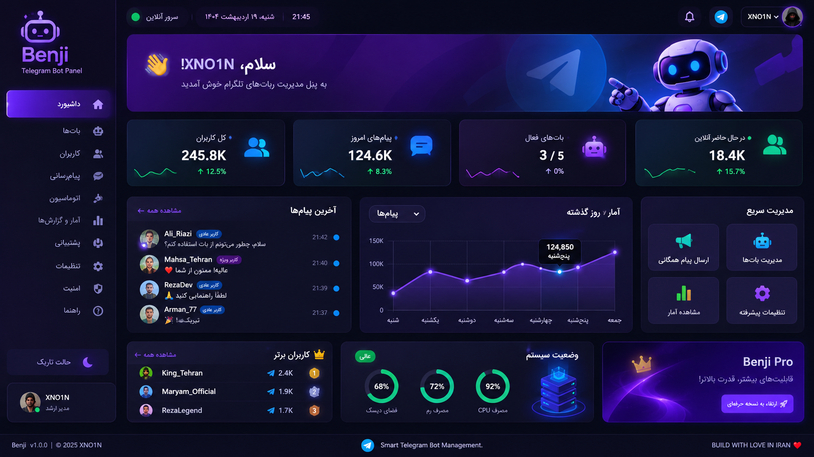

# 🤖 Benji
### Telegram Bot Management Platform

<p align="center">
  <strong>One Dashboard. Total Control. Your Bots, Your Rules.</strong>
</p>

<p align="center">
  🇬🇧 <strong>English</strong> |
  <a href="README.fa.md">🇮🇷 فارسی</a> |
  <a href="README.tr.md">🇹🇷 Türkçe</a>
</p>

<p align="center">
  
</p>

---

## ✨ Features

- 🤖 Multi-Bot Management
- 👥 User Management
- 💬 Live Inbox & Admin Replies
- 📢 Broadcast Messaging
- ⚡ Automation & Custom Commands
- 📊 Analytics Dashboard
- 🎫 Support Center
- 📱 Telegram Mini App
- 🔐 Security & Access Control
- 🎨 Modern Responsive Interface

## 🛠️ Technology Stack

| Technology | Purpose |
|---|---|
| Python | Programming Language |
| FastAPI | Backend |
| aiogram 3 | Telegram Integration |
| React | Frontend |
| TypeScript | Frontend Development |
| PostgreSQL | Database |
| Redis | Cache & Queue |
| Docker | Deployment |

## 🚀 Installation

### Requirements

- Python 3.11+
- Node.js
- PostgreSQL
- Redis
- Telegram Bot Token

### Clone Repository

```bash
git clone https://github.com/YOUR_USERNAME/benji.git
cd benji
```

### Install Dependencies

```bash
pip install -r requirements.txt
```

Create a `.env` file and configure your environment variables.

```env
BOT_TOKEN=your_telegram_bot_token
DATABASE_URL=your_database_url
REDIS_URL=your_redis_url
SECRET_KEY=your_secret_key
```

Start the application using the project's setup instructions.

## 🗺️ Roadmap

- [ ] Multi-Bot Management
- [ ] Live Inbox
- [ ] Admin Replies
- [ ] User Management
- [ ] Broadcast System
- [ ] Automation Engine
- [ ] Analytics Dashboard
- [ ] Telegram Mini App
- [ ] Team Management
- [ ] Docker Deployment
- [ ] Complete Documentation

## 🔐 Security

- Secure credential storage
- Protected admin access
- Input validation
- Role-based permissions
- Safe handling of sensitive information

## 🤝 Contributing

Contributions, ideas, and bug reports are welcome.

1. Fork the repository.
2. Create a new branch.
3. Make your changes.
4. Submit a Pull Request.

## 📄 License

See the repository for license information.

---

<p align="center">
  <strong>BENJI</strong>
  <br>
  Smart Telegram Bot Management
  <br><br>
  <strong>BUILD WITH LOVE IN IRAN ❤️</strong>
  <br>
  <strong>XNO1N</strong>
</p>
