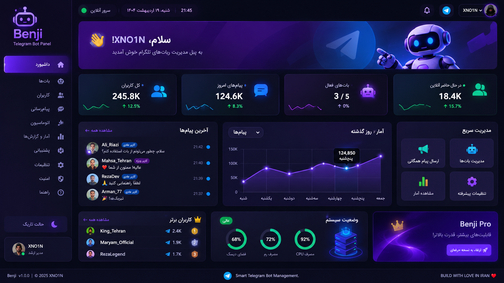

# 🤖 Benji
### Telegram Bot Management Platform

<p align="center">
  <strong>One Dashboard. Total Control. Your Bots, Your Rules.</strong>
</p>

<p align="center">
  <a href="#فارسی">🇮🇷 فارسی</a> •
  <a href="#english">🇬🇧 English</a> •
  <a href="#türkçe">🇹🇷 Türkçe</a>
</p>

<p align="center">
  
</p>

<p align="center">
  
  
  
  
</p>

---

# فارسی

## 🤖 درباره Benji

**Benji** یک پلتفرم مدرن برای مدیریت و کنترل ربات‌های تلگرام است.

با استفاده از Benji می‌توانید چندین ربات تلگرام را از طریق یک پنل مدیریتی حرفه‌ای مدیریت کنید، پیام کاربران را دریافت کنید، پاسخ دهید، کاربران را کنترل کنید و عملکرد ربات‌های خود را زیر نظر داشته باشید.

هدف Benji ساده‌تر کردن مدیریت ربات‌های تلگرام در یک محیط یکپارچه، سریع و امن است.

## ✨ امکانات

- 🤖 **مدیریت چند ربات:** مدیریت چندین ربات تلگرام از یک پنل.
- 👥 **مدیریت کاربران:** مشاهده، مدیریت، مسدودسازی و رفع مسدودیت کاربران.
- 💬 **صندوق پیام زنده:** دریافت و پاسخ مستقیم به پیام کاربران.
- 📢 **ارسال پیام همگانی:** ارسال اطلاعیه و پیام به کاربران.
- ⚡ **اتوماسیون:** ساخت دستورات اختصاصی و پاسخ‌های خودکار.
- 📊 **آمار و گزارش‌ها:** مشاهده فعالیت ربات‌ها و کاربران.
- 🎫 **سیستم پشتیبانی:** مدیریت درخواست‌ها و گفتگوها.
- 📱 **Telegram Mini App:** ارائه تجربه تعاملی در تلگرام.
- 🔐 **امنیت:** مدیریت دسترسی و نگهداری امن اطلاعات.
- 🎨 **رابط کاربری مدرن:** طراحی واکنش‌گرا با حالت تاریک و پشتیبانی از زبان فارسی و RTL.

## 🛠️ فناوری‌های مورد استفاده

| فناوری | کاربرد |
|---|---|
| Python | زبان برنامه‌نویسی |
| FastAPI | بک‌اند |
| aiogram 3 | اتصال به تلگرام |
| React | رابط کاربری |
| TypeScript | توسعه فرانت‌اند |
| PostgreSQL | پایگاه داده |
| Redis | کش و صف پردازش |
| SQLAlchemy | مدیریت دیتابیس |
| Docker | استقرار برنامه |

## 🚀 نصب و راه‌اندازی

### پیش‌نیازها

- Python 3.11 یا بالاتر
- Node.js
- PostgreSQL
- Redis
- توکن ربات تلگرام

### دریافت پروژه

```bash
git clone https://github.com/YOUR_USERNAME/benji.git
cd benji
```

### نصب وابستگی‌ها

```bash
pip install -r requirements.txt
```

### تنظیم متغیرهای محیطی

یک فایل با نام `.env` ایجاد کنید:

```env
BOT_TOKEN=your_telegram_bot_token
DATABASE_URL=your_database_url
REDIS_URL=your_redis_url
SECRET_KEY=your_secret_key
```

سپس برنامه را مطابق دستورالعمل اجرای موجود در پروژه راه‌اندازی کنید.

> توجه: دستورات نهایی اجرا باید با ساختار واقعی سورس پروژه هماهنگ شوند.

## 🗺️ نقشه راه

- [ ] مدیریت چندین ربات
- [ ] صندوق پیام زنده
- [ ] پاسخ‌گویی مدیر به کاربران
- [ ] مدیریت کاربران
- [ ] ارسال پیام همگانی
- [ ] دستورات اختصاصی
- [ ] سیستم اتوماسیون
- [ ] آمار و گزارش‌گیری
- [ ] اتصال Telegram Mini App
- [ ] مدیریت تیم و سطح دسترسی
- [ ] استقرار با Docker
- [ ] مستندات کامل

## 🔐 امنیت

امنیت یکی از اولویت‌های اصلی Benji است.

- نگهداری اطلاعات حساس در فایل محیطی
- محافظت از پنل مدیریت
- اعتبارسنجی ورودی‌ها
- مدیریت سطح دسترسی
- جلوگیری از افشای توکن‌ها و اطلاعات خصوصی

## 🤝 مشارکت در توسعه

از مشارکت شما استقبال می‌کنیم!

1. پروژه را Fork کنید.
2. یک Branch جدید بسازید.
3. تغییرات خود را اعمال کنید.
4. یک Pull Request ارسال کنید.

---

# English

## 🤖 About Benji

**Benji** is a modern platform designed to simplify Telegram bot management.

Manage multiple Telegram bots, monitor users, handle conversations, send broadcasts, and control automation from one centralized dashboard.

Benji aims to provide a powerful, secure, and intuitive management experience for Telegram bot administrators.

## ✨ Features

- 🤖 **Multi-Bot Management:** Manage multiple Telegram bots from one dashboard.
- 👥 **User Management:** View, manage, block, and unblock users.
- 💬 **Live Inbox:** Receive and reply to user messages.
- 📢 **Broadcast System:** Send announcements and updates to your audience.
- ⚡ **Automation:** Create custom commands and automated responses.
- 📊 **Analytics:** Monitor bot activity, users, and messages.
- 🎫 **Support Center:** Manage support tickets and conversations.
- 📱 **Telegram Mini App:** Build interactive experiences inside Telegram.
- 🔐 **Security:** Protected access and secure configuration.
- 🎨 **Modern UI:** Responsive dashboard with Dark Mode and multilingual support.

## 🛠️ Technology Stack

| Technology | Purpose |
|---|---|
| Python | Programming Language |
| FastAPI | Backend |
| aiogram 3 | Telegram Integration |
| React | Frontend |
| TypeScript | Frontend Development |
| PostgreSQL | Database |
| Redis | Cache & Queue |
| SQLAlchemy | ORM |
| Docker | Deployment |

## 🚀 Installation

### Requirements

- Python 3.11+
- Node.js
- PostgreSQL
- Redis
- Telegram Bot Token

### Clone Repository

```bash
git clone https://github.com/YOUR_USERNAME/benji.git
cd benji
```

### Install Dependencies

```bash
pip install -r requirements.txt
```

### Environment Configuration

Create a `.env` file:

```env
BOT_TOKEN=your_telegram_bot_token
DATABASE_URL=your_database_url
REDIS_URL=your_redis_url
SECRET_KEY=your_secret_key
```

Start the application using the commands provided in the project documentation.

## 🗺️ Roadmap

- [ ] Multi-Bot Management
- [ ] Live Inbox
- [ ] Admin Replies
- [ ] User Management
- [ ] Broadcast System
- [ ] Custom Commands
- [ ] Automation Engine
- [ ] Analytics Dashboard
- [ ] Telegram Mini App
- [ ] Team Management
- [ ] Docker Deployment
- [ ] Complete Documentation

## 🔐 Security

Security is a core priority of Benji.

- Secure credential storage
- Protected administrative access
- Input validation
- Role-based permissions
- Safe handling of sensitive information

## 🤝 Contributing

Contributions, ideas, and bug reports are welcome.

1. Fork the repository.
2. Create a new branch.
3. Make your changes.
4. Submit a Pull Request.

---

# Türkçe

## 🤖 Benji Hakkında

**Benji**, Telegram botlarını kolay, hızlı ve güvenli bir şekilde yönetmek için geliştirilmiş modern bir yönetim platformudur.

Birden fazla Telegram botunu tek bir kontrol panelinden yönetebilir, kullanıcıları takip edebilir, mesajları yanıtlayabilir, toplu mesaj gönderebilir ve otomasyon sistemlerini kontrol edebilirsiniz.

Benji, Telegram bot yönetimini daha kolay ve verimli hale getirmeyi amaçlar.

## ✨ Özellikler

- 🤖 **Çoklu Bot Yönetimi:** Birden fazla Telegram botunu tek panelden yönetin.
- 👥 **Kullanıcı Yönetimi:** Kullanıcıları görüntüleyin, yönetin, engelleyin ve engellerini kaldırın.
- 💬 **Canlı Mesaj Kutusu:** Kullanıcı mesajlarını alın ve doğrudan yanıtlayın.
- 📢 **Toplu Mesaj Sistemi:** Kullanıcılara duyuru ve mesaj gönderin.
- ⚡ **Otomasyon:** Özel komutlar ve otomatik yanıtlar oluşturun.
- 📊 **Analiz ve İstatistikler:** Bot ve kullanıcı aktivitelerini takip edin.
- 🎫 **Destek Merkezi:** Destek taleplerini ve konuşmaları yönetin.
- 📱 **Telegram Mini App:** Telegram içinde etkileşimli deneyimler sunun.
- 🔐 **Güvenlik:** Güvenli erişim ve yapılandırma yönetimi.
- 🎨 **Modern Arayüz:** Karanlık mod ve çoklu dil desteğine sahip duyarlı tasarım.

## 🛠️ Teknolojiler

| Teknoloji | Kullanım Alanı |
|---|---|
| Python | Programlama Dili |
| FastAPI | Backend |
| aiogram 3 | Telegram Entegrasyonu |
| React | Frontend |
| TypeScript | Arayüz Geliştirme |
| PostgreSQL | Veritabanı |
| Redis | Önbellek ve Kuyruk |
| SQLAlchemy | ORM |
| Docker | Dağıtım |

## 🚀 Kurulum

### Gereksinimler

- Python 3.11+
- Node.js
- PostgreSQL
- Redis
- Telegram Bot Token

### Depoyu Klonlayın

```bash
git clone https://github.com/YOUR_USERNAME/benji.git
cd benji
```

### Bağımlılıkları Yükleyin

```bash
pip install -r requirements.txt
```

### Ortam Değişkenleri

Bir `.env` dosyası oluşturun:

```env
BOT_TOKEN=your_telegram_bot_token
DATABASE_URL=your_database_url
REDIS_URL=your_redis_url
SECRET_KEY=your_secret_key
```

Uygulamayı proje dokümantasyonunda belirtilen komutlarla başlatın.

## 🗺️ Geliştirme Yol Haritası

- [ ] Çoklu Bot Yönetimi
- [ ] Canlı Mesaj Kutusu
- [ ] Yönetici Yanıtları
- [ ] Kullanıcı Yönetimi
- [ ] Toplu Mesaj Sistemi
- [ ] Özel Komutlar
- [ ] Otomasyon Sistemi
- [ ] Analiz Paneli
- [ ] Telegram Mini App
- [ ] Ekip Yönetimi
- [ ] Docker Desteği
- [ ] Tam Dokümantasyon

## 🔐 Güvenlik

Güvenlik, Benji'nin temel önceliklerinden biridir.

- Güvenli kimlik bilgisi saklama
- Korunan yönetici erişimi
- Girdi doğrulama
- Rol tabanlı yetkilendirme
- Hassas bilgilerin güvenli yönetimi

## 🤝 Katkıda Bulunma

Katkılarınızı, önerilerinizi ve hata bildirimlerinizi bekliyoruz.

1. Depoyu Fork edin.
2. Yeni bir Branch oluşturun.
3. Değişikliklerinizi yapın.
4. Pull Request gönderin.

---

<p align="center">
  <h2>BENJI</h2>
  <strong>Smart Telegram Bot Management</strong>
  <br><br>
  <strong>BUILD WITH LOVE IN IRAN ❤️</strong>
  <br>
  <strong>XNO1N</strong>
</p>
